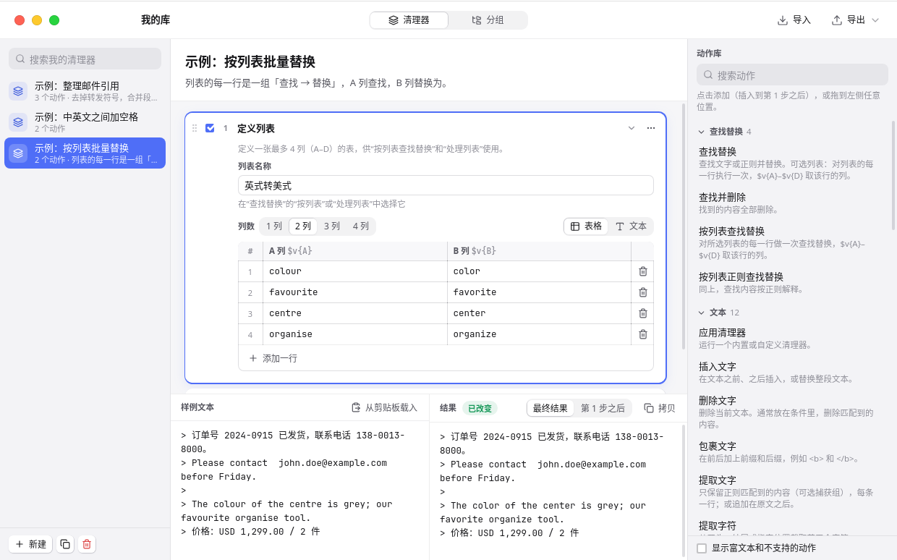
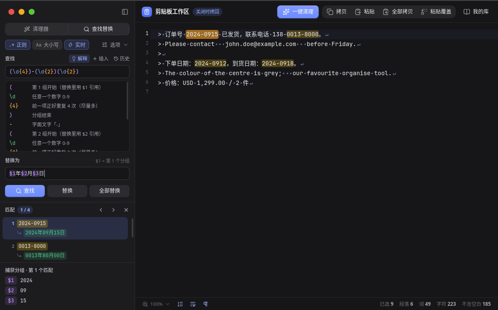

# TextRouter

> 先忠实复刻 TextSoap 9，再在它的基础上优化：剪贴板工作区、一级的查找替换（可切换正则）、清理器与自定义动作链、按列表批量替换。
> A faithful TextSoap 9 re-implementation in Go, using [MyGo](https://github.com/egoist/mygo) (webview mode) with a React + CodeMirror UI.


## 使用方式

整个应用就是一个文本编辑器。剪贴板和文件是同级的文档：

- **剪贴板工作区**：点 Dock 图标（或全局快捷键 `⌥⌘V`、菜单栏图标）打开，自动载入当前剪贴板。编辑完直接关掉窗口，文本会拷回剪贴板（可在偏好设置里关闭）；再次点 Dock 图标时，如果剪贴板变了会重新载入。
- **文件**：`⌘O` 打开、`⌘S` 存储、拖文件进窗口；`⌘N` 新建空白文档。支持 UTF-8/UTF-16（BOM）和 GB18030。

窗口顶部是常用操作：**一键清理**（MyScrub，`⌘J`）、拷贝、粘贴、全部拷贝（`⇧⌘C`）、粘贴覆盖（`⇧⌘V`）、我的库（`⇧⌘L`）。所有修改都能 `⌘Z` 撤销。

### 一级功能：查找替换

`⌘F` 直接打开侧栏的查找替换，光标落在「查找」框里：


- **正则**开关：关闭时按文字查找（`.`、`*` 只代表自己），打开后是 ICU 正则，与 TextSoap 语义一致。
- **实时**：边输入边高亮所有匹配；下方逐条列出「原文 ↓ 替换后」，并给出当前匹配的捕获分组 `$1`…`$9`。替换前就能看清每一处会变成什么。
- 查找框和替换框带语法着色，「解释」把正则逐段翻译成中文；「插入」菜单提供常用片段（数字、任意字符、分组、行首行尾……）和常用模式；「历史」记住最近的查找。
- `⌘G` / `⇧⌘G` 下一个 / 上一个，`⌘E` 用选中文字查找，`⌥⌘G` 替换，`⌥⇧⌘G` 全部替换（一次撤销即可还原）。
- 「选项」里是正则的 `m`/`s`/`x` 选项，或文字模式的匹配方式（包含 / 开头是 / 整个单词 / 结尾是）。

### 二级功能：清理器与我的库

- 侧栏「清理器」页列出当前分组的清理器，单击即应用到选中文字（没选中时作用于全文）；`⌥⌘F` 搜索清理器。共 189 个 TextSoap 9 内置清理器，163 个已实现。
- **我的库**（`⇧⌘L`）编辑自定义清理器：右侧动作库点一下添加动作（插在选中动作之后，或拖到指定位置）；每张动作卡片可停用、上下移、复制、删除，容器动作（分组、重复、条件、宏、处理列表）可以嵌套。底部用样例文本实时预览，每一步显示「改动 N 处 / 无变化 / 出错」，可以切换查看「第 N 步之后」的文本。
- 61 个 TextSoap 动作：41 个完全支持；14 个只影响富文本格式（纯文本下不改变内容，默认隐藏）；6 个依赖 macOS 专有功能或 TextSoap 测试版功能（Clipboard Action、Perform Service、Automator、JavaScript、Ask User、Define Variable），暂不支持。
- **按列表批量替换**：「定义列表」是一张最多 4 列（A–D）的表格，可在表格和制表符文本之间切换；「查找替换」选择「按列表」后，对每一行执行一次，用 `$v{A}`…`$v{D}` 取该行的列。
- 分组页管理侧栏的清理器分组；导入 / 导出 TextSoap 的 `.textsoap9Lib`、`.textsoapCleaner`。



### 其他

- **批量处理文件**（`⇧⌘B`）：选文件或文件夹 → 选清理器 → 写到旁边的 `results/` 子文件夹（或指定文件夹、加前缀/后缀/新扩展名）。永远不会覆盖原文件。
- **偏好设置**（`⌘,`）：主题、启动和关闭剪贴板工作区的行为、MyScrub 使用的清理器、编辑器字体/行号/折行/不可见字符、查找默认选项、全局快捷键。
- 浅色 / 深色 / 跟随系统；可显示空格（·）、制表符（→）和换行（↵）。



## 下载与安装（macOS）

每次推送到 `main`，GitHub Actions 会在 macOS 上构建：打开 **Actions → Build → 最新一次运行 → Artifacts → `TextRouter-macOS`**，里面有 Apple Silicon（`darwin-arm64`）和 Intel（`darwin-amd64`）的 `.dmg` 与 `.app.zip`。打 `v*` 标签时会附到 Release。

包是 ad-hoc 签名、未经 Apple 公证，第一次打开前执行：

```sh
xattr -cr /Applications/TextRouter.app
```

## 自己构建

需要 Go 1.27+ 和 Node 22+（`go.mod` 把 MyGo CLI 固定为 tool）。

```sh
npm --prefix frontend install
go test ./...                                   # 引擎和服务测试
go tool mygo dev                                # 开发运行：Vite 热更新，Go 改动自动重启
go tool mygo build -platform darwin/arm64       # 打包 .app（在 Mac 上还会生成 .dmg）
```

## 架构

```
engine/            纯 Go 核心，不依赖界面
  icu.go regex.go    ICU 正则语法（基于 regexp2）、文字模式转义和匹配方式、替换模板
  action.go          TextSoap 动作节点模型：查找替换、列表、处理列表、条件、宏、行和文字动作
  catalog.go         动作目录（标题、说明、默认参数、支持程度）
  cleaners.go builtins.go groups.go   内置清理器和分组
  textsoap.go        .textsoap9Lib / .textsoapCleaner 导入导出
  explain.go         正则 / 替换模板的中文解释、常用模式
  store.go           资料库和偏好设置（JSON）
main.go            应用、菜单、全局快捷键、菜单栏图标
services.go        绑定给前端的服务：Soap（应用清理器、查找、替换）、Library（资料库、偏好）
documents.go       文档窗口：剪贴板工作区 / 文件 / 空白文档，关闭确认与拷回剪贴板
batch.go           批量处理文件
frontend/          Vite + React + CodeMirror 6
  src/doc/           文档窗口：编辑器、清理器列表、查找替换面板
  src/library/       我的库：清理器编辑器、动作表单、列表表格、分组
  src/prefs/ src/batch/
  src/mygo.ts        MyGo 生成的类型化客户端
```

资料库保存在系统配置目录下的 `TextRouter/library.json`（macOS 为 `~/Library/Application Support/TextRouter/library.json`），可以直接备份。

## 测试

| 测试 | 结果 |
|---|---|
| 清理器实测数据（38 个清理器 × 39 个输入，`engine/testdata/behaviour_truth.json`） | 1482 / 1482 |
| 查找替换实测用例（`regex_cases.json`） | 51 / 51 |
| 在 TextSoap 中执行过的动作链样例（`chain_examples.json`） | 15 / 15 |
| ICU 语法、列表、条件、宏、库导入导出往返、批量输出命名 | 通过 |

实测数据只覆盖 39 个输入，全部通过不代表所有输入都与 TextSoap 一致；其余清理器按官方说明实现。
