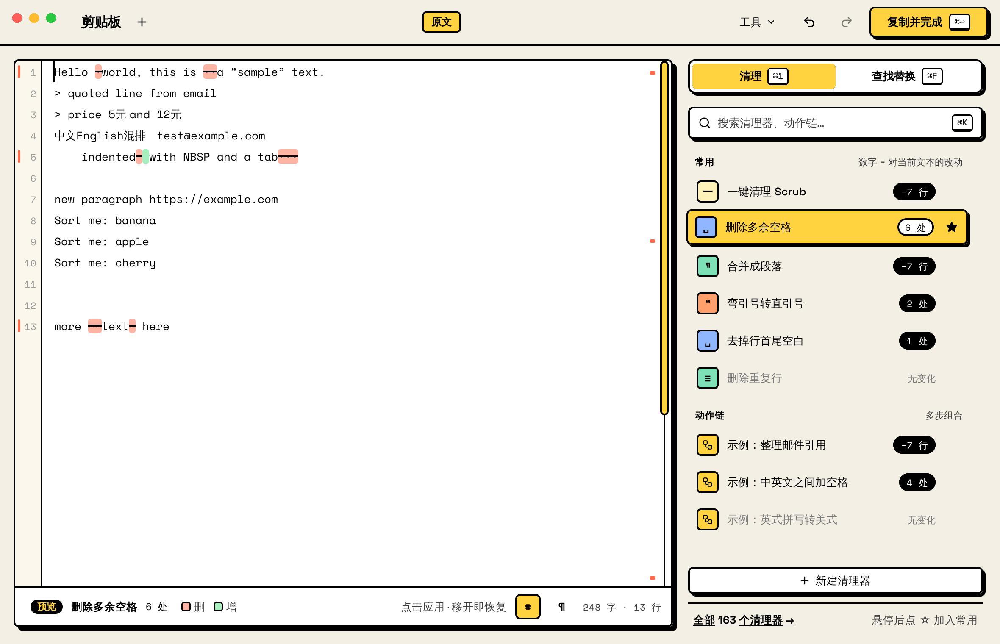
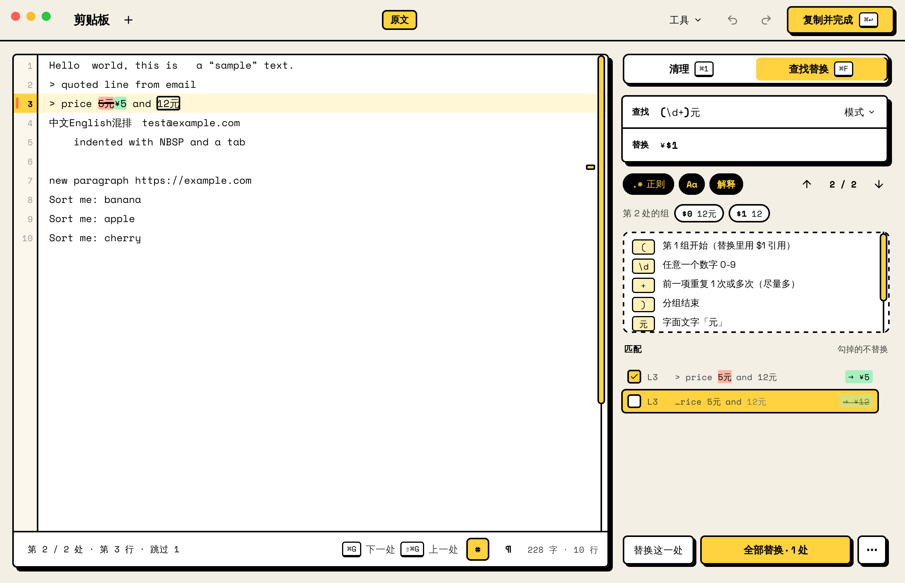
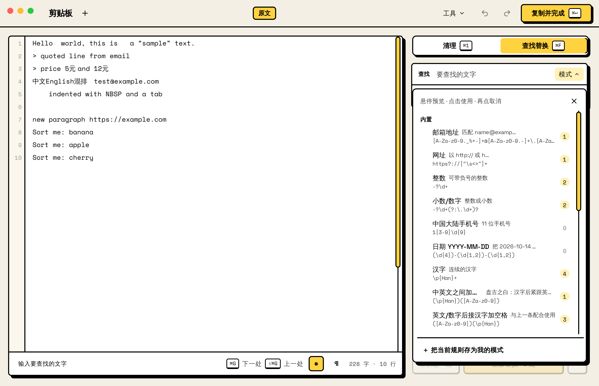
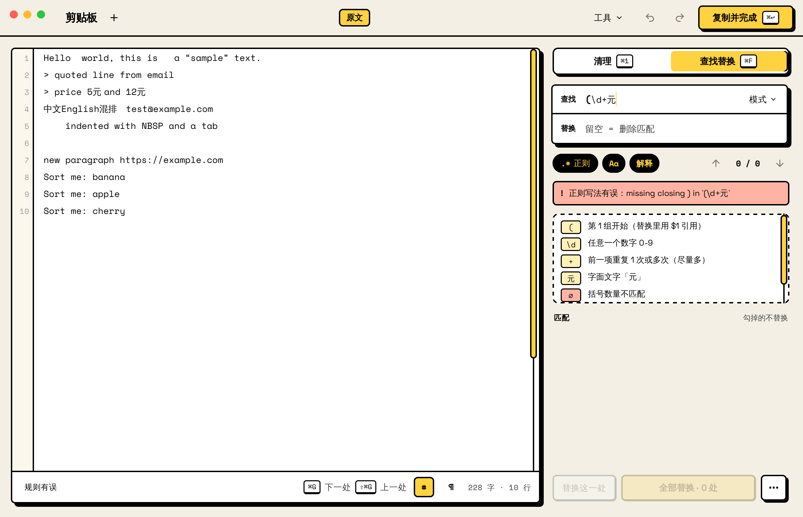
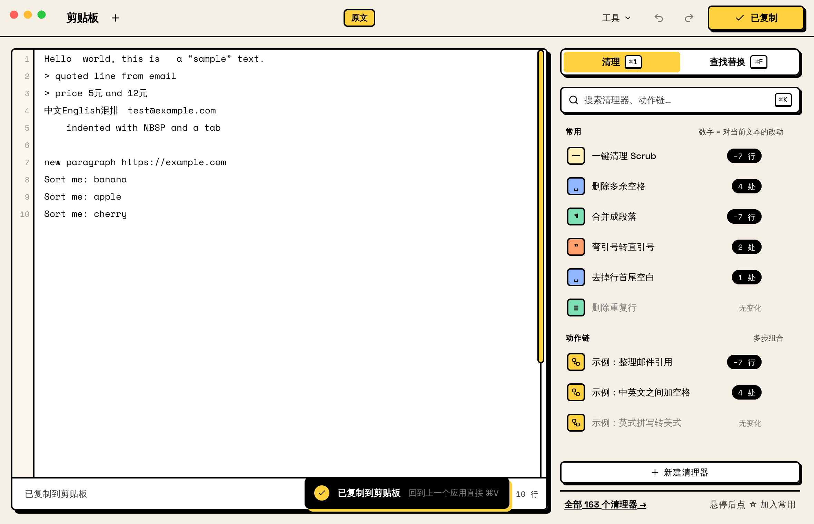
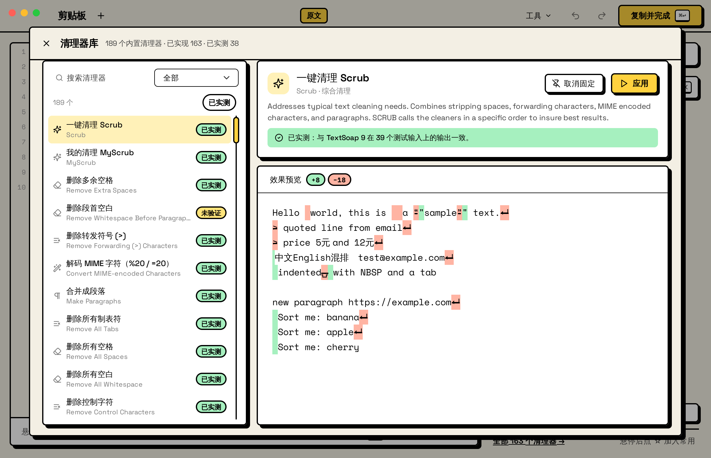
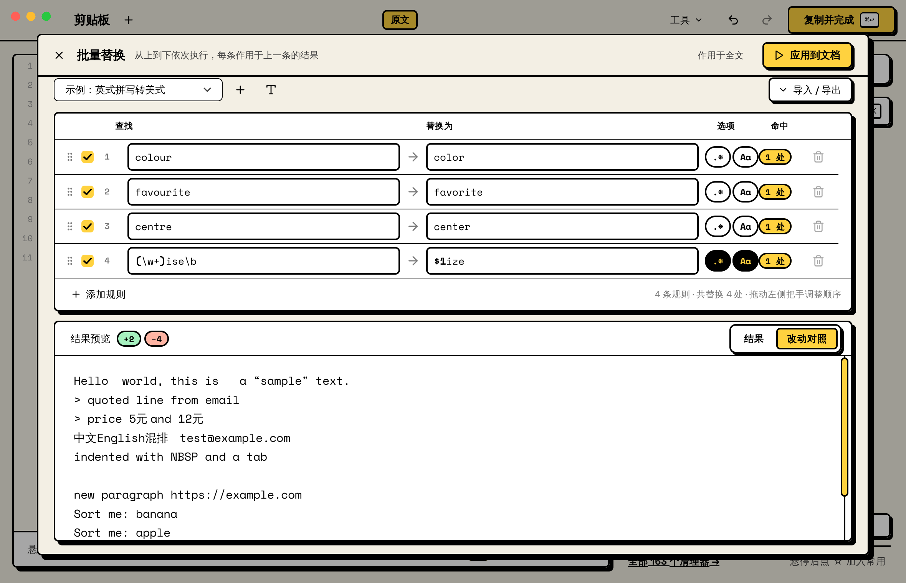
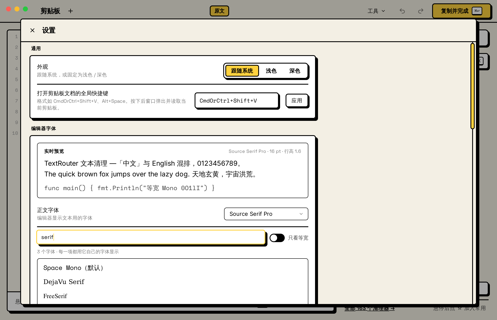

# TextRouter

> 一个重新设计的 TextSoap：剪贴板一键清理、看得懂的查找替换、表格式批量替换、可视化动作链。
> A TextSoap-style text cleaner for macOS, written in pure Go with [MyGo](https://github.com/egoist/mygo) native UI.



## 功能

**界面：新粗野（neo-brutalist）风格**——奶油底、2px 黑描边、不带模糊的硬阴影、黄色高亮；Space Grotesk / Space Mono 字体打包在应用里。所有颜色、描边、阴影、圆角、动效曲线都定义在 `gui/theme_brutal.go`，其余页面（设置、批量替换、动作链、清理器库、⌘K 面板、菜单）都用同一套，菜单也是应用内绘制，不是系统原生菜单。设计规格见 [`docs/design/clipboard-redesign.md`](docs/design/clipboard-redesign.md)。

**剪贴板窗口**
- 左边是文本（白色卡片，行号栏、改动竖条、滚动条旁的刻度）；右边 348px 是两个标签页：**清理 ⌘1** 和 **查找替换 ⌘F**。标题栏中间是**步骤记录**：`原文 → 删除重复行 → [整理邮件引用]`，点任一步回到那一步（历史不删，可再前进），两步以上可「存为动作链」。
- **清理**标签：搜索（⌘K）、「常用」和「动作链」两组。每行带一个**改动徽标**——这个清理器对当前文本实际会改多少（「−3 行」/「5 处」/「无变化」），文本没变就不重算。**悬停＝预览**：正文立刻标出会删（红底划线，空格显示为 `·`、换行 `⏎`）和会增（绿底）的内容，状态栏写明改动量；移开恢复，点击才应用，应用时删掉的文字淡出、新增的文字先黑框再褪色。悬停行时点 ☆ 加入常用。底部有「＋ 新建清理器」，直接进动作链编辑器从零搭一个。
- **查找替换**标签：上下两格（查找 / 替换）合成一个框；`.* 正则`、`Aa`、`解释` 三个开关；`↑ 3 / 12 ↓` 计数。正则写错会抖一下并禁用替换；捕获组显示成可点的小块（点一下把 `$n` 加进替换框）；「解释」展开逐段中文说明；匹配列表每行一个复选框，**勾掉的不替换**，「全部替换 · N 处」的 N 随勾选变化；点一行或 ⌘G / ⇧⌘G 跳转，**正文、列表、行号高亮、滚动条刻度同步**。有选区时自动只在选区内查找（「仅选区 ×」可取消）。
- **模式菜单**：内置模式（数字、价格、日期、手机号、邮箱、网址、连续空格、中英文相邻……）和「我的模式」。悬停＝在正文里只标出匹配；点击套用并记住原来的查找 / 替换 / 正则，再点一次或点标签上的 × 就恢复；也能把当前规则存为我的模式。
- 提示条、悬停提示（停 0.45 秒才出现）、键帽、复制成功的对勾动画；系统开了「减少动态效果」时所有动画瞬间完成。
- 快捷键：⌘↩ 复制并完成，⌘K 动作面板，⌘1 / ⌘F 切标签，⌘G / ⇧⌘G 下一处 / 上一处，⌥⌘↩ 替换这一处，⌘Z / ⇧⌘Z 撤销 / 重做，⌘W 关闭窗口。

**信息架构（照 TextSoap）**
- 主窗口就是一个文本文档。「剪贴板」是固定的第一个文档，打开的文件（⌘O、拖入窗口、拖到 Dock 图标、「打开方式」）是它旁边的同级标签。**文件标签可以向下拖出标题栏**（或右键 → 在新窗口中打开）变成独立窗口，带着未保存的修改。
- 二级功能以面板（sheet）打开：批量替换、我的清理器（动作链）、清理器库、批量处理文件、设置——入口是标题栏的「工具 ▾」、菜单栏「工具」和 ⌘K。

**剪贴板文档**
- 每次激活（启动、点 Dock 图标、切回本应用、点菜单栏图标、全局快捷键）都切到「剪贴板」并读取最新剪贴板（设置 →「激活时自动读取剪贴板」，默认开）：
  - 剪贴板没变：文档一点不动（光标、选区、撤销都保留）。
  - 剪贴板变了、文档没被编辑过：静默载入（可撤销）。
  - 剪贴板变了、但文档有尚未复制出去的编辑：**不载入**，文档原样保留；标题栏出现小提示「剪贴板有新内容 · 载入」，点了才载入（可 ⌘Z 找回之前的编辑）。

**应用图标**：内置 5 款（Neon Routes、Mint Minimal、Terminal Pixels、Tactile Wood、Cosmic Flow），默认第二款；设置 → 应用图标里切换，Dock 图标立刻变并记住选择。

**批量替换**——把 TextSoap 难懂的行/列换成规则表
- 每一行就是一条规则：`☑ 启用 | 查找 → 替换为 | .* 正则 | Aa 区分大小写 | 命中 N 处 | ✕`。
- 明确的执行顺序：从上到下，每条作用于上一条的结果；拖动行即可调整顺序。
- 每条规则单独显示命中次数，正则写错的行会标红；底部实时显示合并后的结果（可切换改动对照）。
- 导入 / 导出 CSV、TSV，也可以直接粘贴从 Excel / Numbers 复制的表格。

**动作链**（TextSoap 的「自定义清理器」）
- 竖排步骤卡片：应用清理器、查找替换、查找删除、批量替换、提取匹配、插入/包裹文字、每行加/删文字、行排序、折行、引用、标题式大小写、截取字符、逐行处理、对匹配内容处理、分组、重复、调用其他动作链、备注。
- 每一步显示改动量，并可展开「这一步之后的文本」；步骤可开关、上下移、复制、删除；容器步骤可以嵌套子步骤。
- 可固定到「常用」；导入 TextSoap 清理器库（`.textsoap9Lib` 二进制 plist），导出为 TextSoap 可读的格式（`fileVersion 6`）。

**清理器库**：189 个 TextSoap 9 内置清理器，163 个已实现；每个都能预览对当前文本的效果并固定到主界面。标签：`已实测`（38 个，与 TextSoap 实测输出逐条一致）/ `未验证`（按官方说明实现）/ `富文本`（只影响字体格式，纯文本下不改变内容）。

**编辑器**（基于 MyGo 的 ui/editor，已改成上面的新样式）：行号（点行号选整行）、选中即「作用于选区」（动作 / 查找替换 / 批量替换 / 动作链都只改选区，多选区也行），显示不可见字符（空格、制表符、换行 ¬、NBSP ⍽、全角空格 □、零宽字符），自动换行、⌘+ / ⌘- 缩放，多光标（⌘D、⇧⌘L、⌥⌘↑↓、⌥ 拖动列选），转到行（⌘L），⌥↑↓ 移动行、⇧⌥↓ 复制行、⇧⌘K 删除行、排序 / 反转 / 去重 / 合并行、大小写转换，括号和引号自动配对；打字与动作共用一条步骤记录；拖入文本文件打开，⌘O / ⌘S 打开存储。

**改动高亮**：每次动作 / 替换后，编辑器里只高亮真正改动的字符（字符级 diff：新增的字先带 2px 黑框，1.3 秒内底色褪去，删除处一条红色竖线），任何输入立即清除。

**不可见字符**：¬ 换行（\r\n 文件显示 ¬↵）、⍽ NBSP、□ 全角空格、‸ 零宽字符、↵ 单独的 CR 都画在文字上方，不占任何宽度——开关时文字一个像素都不会移动。

**记住视图**：行号、不可见字符、缩放、右侧标签与查找模式、窗口大小、字体都保存在资料库 JSON（`settings.view`），下次启动恢复。

**字体设置**：设置 → 编辑器字体。扫描系统字体目录（macOS：/System/Library/Fonts、/Library/Fonts、~/Library/Fonts）读出所有字体族，每一项用它自己的字体显示，可搜索、可只看等宽；分别设置正文字体、中文后备字体、界面字体（可选）、字号、行高，带实时预览。

**批量处理文件**：选文件或文件夹 → 选动作链/规则集/清理器 → 先预览哪些文件会变 → 再写入（可选 `.bak` 备份）。

**其他**：键盘优先（⌘F、⌘1、⌘, 设置、⌘K、⌘↩、⇧⌘R 批量替换）。新粗野只有一套配色，设置里的「外观」只影响系统窗口外框，不再切换深色界面。

| 悬停预览 | 查找替换 + 勾掉不替换 |
|---|---|
|  |  |
| **模式菜单** | **正则出错 + 解释** |
|  |  |
| **工具菜单（应用内绘制）** | **复制成功提示** |
|  |  |
| **清理器库** | **批量替换（sheet）** |
|  |  |
| **我的清理器（sheet）** | **⌘K** |
|  |  |
| **文件文档（同级标签）** | **设置** |
|  |  |

## 下载与安装（macOS）

到 [Releases](../../releases) 下载：Apple 芯片选 `darwin-arm64`，Intel 选 `darwin-amd64`，各有 `.dmg` 和 `.app.zip`。也可以在 Actions → Build → 某次运行 → Artifacts → `TextRouter-macOS` 取开发中的版本（推送到 `main`、提 PR 或手动运行都会构建；打 `v*` 标签时自动发 Release）。

包是 ad-hoc 签名、未经 Apple 公证，第一次打开前执行：

```sh
xattr -cr /Applications/TextRouter.app
```

全局快捷键无需额外权限。把文本文件拖到 Dock 图标上会作为标签打开（安装包里声明了纯文本类型，优先级为「备选」，不会抢你的默认打开方式）。

## 自己构建

需要 Go 1.27+（`go.mod` 固定了 MyGo CLI 为 tool）。

```sh
go test ./...                                   # 引擎测试 + 界面测试（无窗口）
go tool mygo dev                                # 开发运行，改代码自动重启
go tool mygo build -platform darwin/arm64       # 打包 .app（在 Mac 上还会生成 .dmg）
```

MyGo 不需要 cgo，在 Linux 上也能交叉编译出 macOS 的 `.app`（`GOOS=darwin` 或 `mygo build -platform darwin/arm64`），只有 `.dmg` 必须在 macOS 上生成。

## MyGo 的改动（third_party/mygo）

仓库里带了一份 MyGo v0.4.8 的副本（`go.mod` 里 `replace`），加了这些：

- **编辑器**（`ui/editor`）：`State.Highlights`（字符范围背景 + 描边、删除线、下划线、扩散环、从左擦入）与 `HighlightInset`；`State.Invisibles`（不占位的不可见字符）；`State.Gutter`（行号栏：按位数定宽、右侧描边、改动竖条、当前行与选中行底色）；描边滚动条；`ScrollOffset` / `SetScrollOffset` / `LineTop`；光标闪烁周期 1.06s。
- **`ui` 主题**：`Theme.ScrollbarOutline` 等——带描边的药丸滑块和轨道线，常驻显示，并给竖向滚动区域在右侧留出 16px，内容不会压在滚动条底下。
- tooltip 延迟改为 0.45 秒。

对应的 MyGo 测试也相应调整，`cd third_party/mygo && go test ./ui ./ui/editor` 通过。

## 架构

```
engine/        纯 Go 核心，不依赖界面，可单独使用和测试
  regex.go       查找替换：按 TextSoap 实测语义实现（见下）
  cleaners.go    清理器注册表（读取内嵌的 TextSoap 清单 data/builtin_inventory.json）
  builtins.go    各清理器实现
  chain.go       动作链 Step/Chain 与执行（带逐步结果，用于预览）
  batch.go       批量规则 + CSV/TSV
  explain.go     正则 / 替换串的中文解释、常用模式
  textsoap.go    TextSoap 库导入、fileVersion 6 导出
  store.go       配置与资料库（JSON）
  diff.go files.go
gui/           MyGo 原生界面；只依赖 engine 和一个小的 Platform 接口
  theme_brutal.go  设计令牌：颜色、描边、硬阴影、圆角、曲线、时长
  style.go         按钮、输入框、卡片等原子组件；ws_menu.go 应用内菜单
  ws_view.go       窗口：标题栏、步骤记录、右栏；ws_body.go 正文卡片与状态栏
  ws_clean.go      清理标签；ws_find.go 查找替换标签与模式菜单
  ws_preview.go    悬停预览（engine.Diff / FindAll 生成）；ws_core.go 步骤记录、提示条
main.go        窗口、菜单栏图标、全局快捷键、Dock、对话框（实现 Platform）
```

用户数据保存在 `~/Library/Application Support/TextRouter/library.json`（动作链、规则集、设置），可以直接备份或手改。

### 实测语义（与 TextSoap 9 一致）

- 大小写只由「区分大小写」决定；`regex_options` 里的 `i` 无效，内联 `(?i)` 有效。
- 只有小写 `m`（^$ 按行）和 `s`（. 匹配换行）两个选项字母生效。
- 替换记号：`$0`–`$9`（只取一位数字，`$01` = `$0` + `1`）、`$U`/`$L` 之后全部大/小写、`$u`/`$l` 下一个字符大/小写、`$E`/`$e` 结束（本身为空）、`\$` 是美元符号；`$$` 为空，`${1}` 不支持，其他 `$x` 会被丢掉。
- 文字模式下替换串原样插入。
- 批量替换表里的正则规则默认开启多行（`^`/`$` 按行）——这是 TextRouter 有意的改动，更符合表格使用直觉。

### 添加一个清理器

在 `engine/builtins.go` 的 `init()` 里注册：

```go
reg("#MY_TOKEN", "我的清理器", func(s string) string {
    return strings.ReplaceAll(s, "，", ", ")
})
```

如果 token 不在 TextSoap 清单里，同时在 `engine/data/builtin_inventory.json` 的 `cleaners` 里加一条 `{"token": "#MY_TOKEN", "name": "My Cleaner", "description": "..."}`。它会自动出现在清理器库、⌘K 面板和动作链的「应用清理器」里。

### 添加一种动作（动作链步骤）

1. 在 `engine/chain.go` 加一个 `Kind…` 常量，在 `Step.Apply` 的 `switch` 里实现；
2. 在 `Actions()` 里登记标题、说明和要编辑的字段（`text`、`find`、`width`……）；
3. 字段编辑器在 `gui/chains.go` 的 `stepFields` 中，已有字段会自动显示，新字段在那里加一段即可。

## 测试与兼容性

| 测试 | 结果 |
|---|---|
| 清理器实测数据（38 个清理器 × 39 输入，`engine/testdata/behaviour_truth.json`） | 1482 / 1482 |
| 查找替换实测用例（`regex_cases.json`） | 51 / 51 |
| 在 TextSoap 中执行过的动作链样例（`chain_examples.json`） | 15 / 15 |
| 界面测试（`gui/*_test.go`，MyGo Tester 无窗口运行：悬停预览、徽标与应用结果一致、跳转同步、勾掉不替换、模式菜单、步骤记录、撕出标签等） | 41 个测试通过 |

注意：实测数据只覆盖 39 个输入，100% 通过不代表所有输入都与 TextSoap 一致；其余 151 个未实测清理器按说明实现，界面中标为「未验证」。

## English (short)

TextRouter reimplements TextSoap 9's text cleaning with a clearer UX: a Clipboard Space opened by Dock/menu-bar/global shortcut, a find/replace screen that explains regexes and replacement tokens in plain language with per-match previews, batch replace as an ordered rule table (drag to reorder, per-rule hit counts, CSV/TSV), and a step-by-step chain builder with previews after each step. Pure Go (`engine/` has no UI deps), native UI via MyGo. `go test ./...`; `go tool mygo build -platform darwin/arm64`.

## 第三方资源 / Credits

- 界面图标：[Lucide](https://lucide.dev)（ISC，见 `gui/icons/LICENSE`）
- 字体：[Space Grotesk](https://github.com/floriankarsten/space-grotesk) 与 [Space Mono](https://github.com/googlefonts/spacemono)（SIL OFL 1.1，见 `gui/fonts/OFL-SpaceGrotesk.txt`、`OFL-SpaceMono.txt`）、[Inter](https://rsms.me/inter/)（SIL OFL 1.1，见 `gui/fonts/OFL.txt`）；中文回退到系统的苹方 / Noto Sans SC
- 应用图标：5 款由作者提供（`gui/appicons/`）
