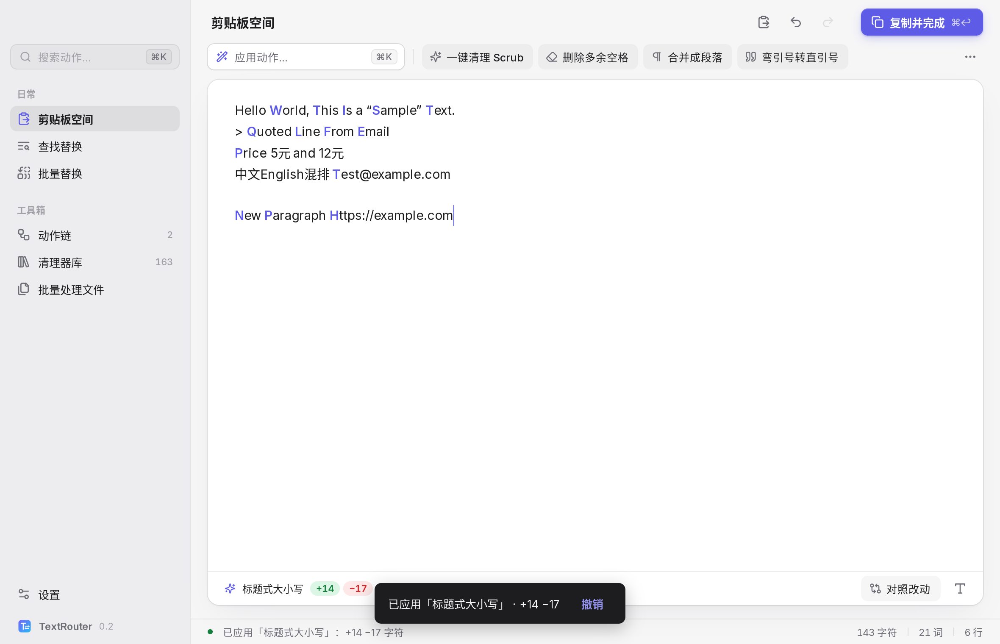
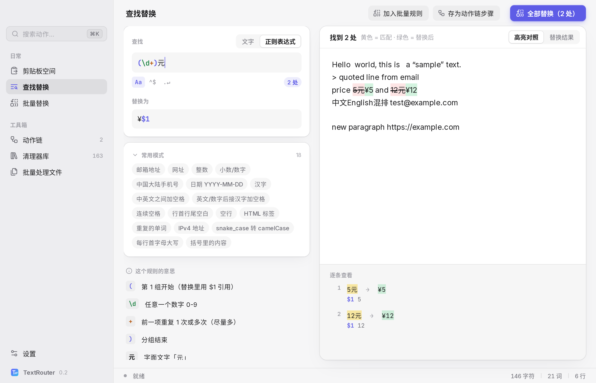
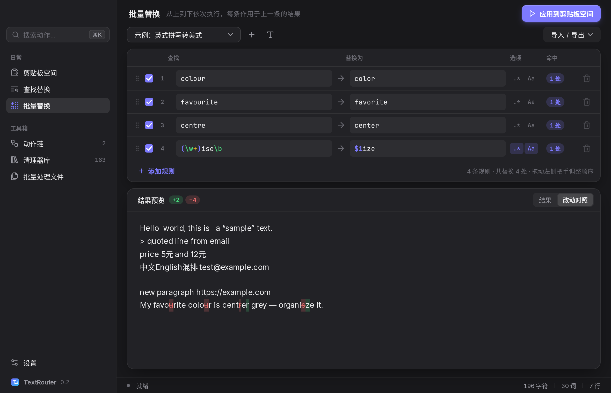
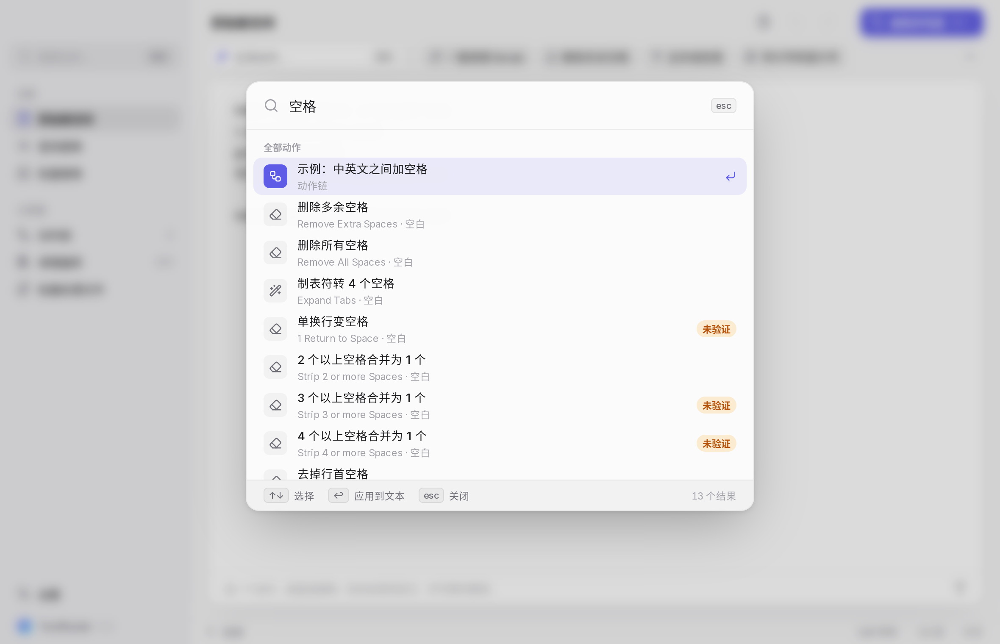

# TextRouter

> 一个重新设计的 TextSoap：剪贴板一键清理、看得懂的查找替换、表格式批量替换、可视化动作链。
> A TextSoap-style text cleaner for macOS, written in pure Go with [MyGo](https://github.com/egoist/mygo) native UI.



## 功能

**剪贴板空间（主界面）**
- 点 Dock 图标 / 菜单栏图标 / 全局快捷键（默认 `⌘⇧V`，可在设置里改）→ 窗口弹出并自动读入当前剪贴板。
- 常用清理器和动作链是一排按钮，点一下就生效；每一步都能撤销（⌘⇧Z 重做），可展开查看「红删绿增」的改动对照。
- `⌘K` 打开动作面板，中英文、模糊搜索全部清理器 / 动作链 / 规则集，回车即应用。
- `⌘↩` 复制回剪贴板并收起（macOS 上会把焦点还给之前的应用，直接 ⌘V 即可粘贴）。

**查找替换**——为正则新手设计
- 默认「文字」模式（`.`、`*` 只代表自己），一键切到「正则表达式」。
- 左边逐段用中文解释规则：`(\d+)` → “第 1 组开始（替换里用 $1 引用）”、“任意一个数字”……替换串里的 `$1`、`$U` 等记号也逐个解释，写错的记号（如 `$$`、`${1}`）会标红并告诉你为什么。
- 右边实时预览：原文中每一处匹配标黄/划掉，紧跟着显示替换后的内容；下方逐条列出 `#1 5元 → ¥5  $1=5`。
- 18 个常用模式一键填入：邮箱、网址、数字、手机号、日期、汉字、中英文之间加空格、连续空格、空行、HTML 标签、重复单词、snake_case→camelCase……
- 可直接「加入批量规则」或「存为动作链步骤」。

**批量替换**——把 TextSoap 难懂的行/列换成规则表
- 每一行就是一条规则：`☑ 启用 | 查找 → 替换为 | .* 正则 | Aa 区分大小写 | 命中 N 处 | ✕`。
- 明确的执行顺序：从上到下，每条作用于上一条的结果；拖动行即可调整顺序。
- 每条规则单独显示命中次数，正则写错的行会标红；底部实时显示合并后的结果（可切换改动对照）。
- 导入 / 导出 CSV、TSV，也可以直接粘贴从 Excel / Numbers 复制的表格。

**动作链**（TextSoap 的「自定义清理器」）
- 竖排步骤卡片：应用清理器、查找替换、查找删除、批量替换、提取匹配、插入/包裹文字、每行加/删文字、行排序、折行、引用、标题式大小写、截取字符、逐行处理、对匹配内容处理、分组、重复、调用其他动作链、备注。
- 每一步显示改动量，并可展开「这一步之后的文本」；步骤可开关、上下移、复制、删除；容器步骤可以嵌套子步骤。
- 可固定到剪贴板空间；导入 TextSoap 清理器库（`.textsoap9Lib` 二进制 plist），导出为 TextSoap 可读的格式（`fileVersion 6`）。

**清理器库**：189 个 TextSoap 9 内置清理器，163 个已实现；每个都能预览对当前文本的效果并固定到主界面。标签：`已实测`（38 个，与 TextSoap 实测输出逐条一致）/ `未验证`（按官方说明实现）/ `富文本`（只影响字体格式，纯文本下不改变内容）。

**批量处理文件**：选文件或文件夹 → 选动作链/规则集/清理器 → 先预览哪些文件会变 → 再写入（可选 `.bak` 备份）。

**其他**：浅色 / 深色 / 跟随系统；键盘优先（⌘1–5 切换页面、⌘, 设置、⌘K、⌘↩）。

| 查找替换 | 批量替换（深色） |
|---|---|
|  |  |
| **动作链** | **⌘K 动作面板** |
|  |  |

## 下载与安装（macOS）

每次推送到 `main`，GitHub Actions 会在 macOS 上构建：打开仓库的 **Actions → Build → 最新一次运行 → Artifacts → `TextRouter-macOS`**，里面有 Apple Silicon（`darwin-arm64`）和 Intel（`darwin-amd64`）的 `.dmg` 与 `.app.zip`。打 `v*` 标签时会附到 Release。

包是 ad-hoc 签名、未经 Apple 公证，第一次打开前执行：

```sh
xattr -cr /Applications/TextRouter.app
```

全局快捷键无需额外权限。

## 自己构建

需要 Go 1.27+（`go.mod` 固定了 MyGo CLI 为 tool）。

```sh
go test ./...                                   # 引擎测试 + 界面测试（无窗口）
go tool mygo dev                                # 开发运行，改代码自动重启
go tool mygo build -platform darwin/arm64       # 打包 .app（在 Mac 上还会生成 .dmg）
```

MyGo 不需要 cgo，在 Linux 上也能交叉编译出 macOS 的 `.app`（`GOOS=darwin` 或 `mygo build -platform darwin/arm64`），只有 `.dmg` 必须在 macOS 上生成。

## 架构

```
engine/        纯 Go 核心，不依赖界面，可单独使用和测试
  regex.go       查找替换：按 TextSoap 实测语义实现（见下）
  cleaners.go    清理器注册表（读取内嵌的 TextSoap 清单 data/builtin_inventory.json）
  builtins.go    各清理器实现
  chain.go       动作链 Step/Chain 与执行（带逐步结果，用于预览）
  batch.go       批量规则 + CSV/TSV
  explain.go     正则 / 替换串的中文解释、常用模式
  textsoap.go    TextSoap 库导入、fileVersion 6 导出
  store.go       配置与资料库（JSON）
  diff.go files.go
gui/           MyGo 原生界面；只依赖 engine 和一个小的 Platform 接口
main.go        窗口、菜单栏图标、全局快捷键、Dock、对话框（实现 Platform）
```

用户数据保存在 `~/Library/Application Support/TextRouter/library.json`（动作链、规则集、设置），可以直接备份或手改。

### 实测语义（与 TextSoap 9 一致）

- 大小写只由「区分大小写」决定；`regex_options` 里的 `i` 无效，内联 `(?i)` 有效。
- 只有小写 `m`（^$ 按行）和 `s`（. 匹配换行）两个选项字母生效。
- 替换记号：`$0`–`$9`（只取一位数字，`$01` = `$0` + `1`）、`$U`/`$L` 之后全部大/小写、`$u`/`$l` 下一个字符大/小写、`$E`/`$e` 结束（本身为空）、`\$` 是美元符号；`$$` 为空，`${1}` 不支持，其他 `$x` 会被丢掉。
- 文字模式下替换串原样插入。
- 批量替换表里的正则规则默认开启多行（`^`/`$` 按行）——这是 TextRouter 有意的改动，更符合表格使用直觉。

### 添加一个清理器

在 `engine/builtins.go` 的 `init()` 里注册：

```go
reg("#MY_TOKEN", "我的清理器", func(s string) string {
    return strings.ReplaceAll(s, "，", ", ")
})
```

如果 token 不在 TextSoap 清单里，同时在 `engine/data/builtin_inventory.json` 的 `cleaners` 里加一条 `{"token": "#MY_TOKEN", "name": "My Cleaner", "description": "..."}`。它会自动出现在清理器库、⌘K 面板和动作链的「应用清理器」里。

### 添加一种动作（动作链步骤）

1. 在 `engine/chain.go` 加一个 `Kind…` 常量，在 `Step.Apply` 的 `switch` 里实现；
2. 在 `Actions()` 里登记标题、说明和要编辑的字段（`text`、`find`、`width`……）；
3. 字段编辑器在 `gui/chains.go` 的 `stepFields` 中，已有字段会自动显示，新字段在那里加一段即可。

## 测试与兼容性

| 测试 | 结果 |
|---|---|
| 清理器实测数据（38 个清理器 × 39 输入，`engine/testdata/behaviour_truth.json`） | 1482 / 1482 |
| 查找替换实测用例（`regex_cases.json`） | 51 / 51 |
| 在 TextSoap 中执行过的动作链样例（`chain_examples.json`） | 15 / 15 |
| 界面测试（`gui/gui_test.go`，MyGo Tester 无窗口运行） | 6 个场景通过 |

注意：实测数据只覆盖 39 个输入，100% 通过不代表所有输入都与 TextSoap 一致；其余 151 个未实测清理器按说明实现，界面中标为「未验证」。

## English (short)

TextRouter reimplements TextSoap 9's text cleaning with a clearer UX: a Clipboard Space opened by Dock/menu-bar/global shortcut, a find/replace screen that explains regexes and replacement tokens in plain language with per-match previews, batch replace as an ordered rule table (drag to reorder, per-rule hit counts, CSV/TSV), and a step-by-step chain builder with previews after each step. Pure Go (`engine/` has no UI deps), native UI via MyGo. `go test ./...`; `go tool mygo build -platform darwin/arm64`.

## 第三方资源 / Credits

- 图标：[Lucide](https://lucide.dev)（ISC，见 `gui/icons/LICENSE`）
- 界面字体：[Inter](https://rsms.me/inter/)（SIL OFL 1.1，见 `gui/fonts/OFL.txt`），中文回退到系统的苹方
